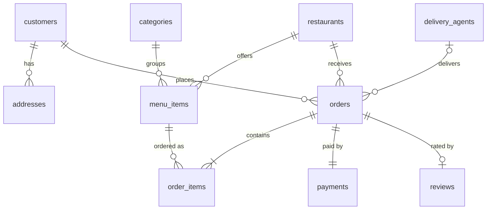

# PlateRun: Online Food Management System (DBMS 24CS303 mini-project) · v2
Stack: Node.js/Express + Supabase (PostgreSQL) + vanilla JS frontend. Case study: food ordering (adapted from the syllabus list).

## Run
1. Create a Supabase project, open SQL Editor, run in order: `db/01` → `02` → `03` → `04` → `05` → **`06_upgrade.sql`** → `07_tests.sql`.
   (Already ran 01-05? Just run `06` and `07`; your data is kept. `06` is safe to run twice.)
2. `cd server && cp .env.example .env`, then fill in `DATABASE_URL` **and `ADMIN_KEY`** (admin login is off until you set one).
3. `npm install && npm start`, then open http://localhost:3000
4. Demo customers (`asha@x.com`, `ravi@x.com`, `meena@x.com`, ...) all use password `demo123`. New users can create an account on the login screen.

> `05_optimization.sql` adds 50,000 fake delivered orders for the EXPLAIN demo. They show up in reports. To remove them afterwards:
> `DELETE FROM orders o WHERE NOT EXISTS (SELECT 1 FROM order_items oi WHERE oi.order_id = o.order_id); REFRESH MATERIALIZED VIEW mv_restaurant_sales;`

## What's new in v2
**Security fixes**
- Customers now sign in with a password (bcrypt via `pgcrypto`, checked inside the database). Before, anyone could log in with just an email.
- Signed session tokens. The customer id comes from the token, not from the request, so nobody can order as someone else.
- Order status changes: customers may only cancel **their own** orders; only the admin can move orders forward. (Before, any visitor could change any order.)
- Reports, restock, EOD and EXPLAIN are admin-only. The hard-coded `admin123` key is gone; `ADMIN_KEY` is required.
- Input validation, login rate-limit, no raw database errors sent to the browser, CORS closed unless `CORS_ORIGIN` is set.

**Database features**
- `status_flow` table: the legal order-status moves are data, enforced by trigger (no jumping PLACED → DELIVERED).
- `payments.status` (PENDING / PAID / REFUNDED / VOID): cash-on-delivery stays pending until delivered; cancelling refunds or voids.
- `reviews` table (1 per delivered order, kept in 3NF) + trigger `trg_review_guard` + view `v_restaurant_rating`.
- Views `v_daily_sales`, `v_low_stock`; `v_order_summary` now includes payment and rating.
- `place_order` v2: merges duplicate lines and locks rows in `item_id` order, so concurrent orders cannot deadlock; checks address owner and payment method.
- `fn_register` (validated sign-up in one transaction) and `fn_add_review`.

**App**: create-account screen, payment status on orders, star ratings after delivery, restaurant ratings on the menu, admin 7-day sales, low stock, status history (audit log) and Cancel button.

## Test cases (for your report)
`SELECT * FROM fn_run_tests();` runs 27 checks (login, hashing, totals, stock, atomicity, workflow, refunds, reviews) and shows expected vs actual with a pass flag. It rolls back everything it does, so your data is unchanged. Take a screenshot of the result for the Testing chapter.

## ER diagram (Unit I)

`status_flow` (allowed moves), `audit_log` and `daily_settlement` are standalone support tables.

## Syllabus map
| Unit | Where |
|---|---|
| I ER → relational mapping | `01_schema_er.sql` (comments explain each mapping) |
| II SQL, views, sequences, cursors, procedures, triggers, exceptions, dynamic SQL | `01`, `03`, `06` (3 triggers, functions, 6 views) |
| III Normalization 1NF–5NF, de-normalization | `02_normalization.sql` (+ `reviews` kept in 3NF) |
| IV ACID, 2PL, savepoints, isolation, deadlock, recovery | `04_transactions.sql`, `place_order` in `06` (deadlock-safe lock order) |
| V EXPLAIN, indexes, join methods, EOD batch, NoSQL | `05_optimization.sql`, `nosql/orders_mongo.js` |
| Testing | `07_tests.sql` |

## API
Public: `POST /api/register` · `POST /api/login` · `POST /api/admin/login` · `GET /api/menu` · `GET /api/health`
Signed-in: `POST /api/orders` · `GET /api/orders` · `PATCH /api/orders/:id/status` · `POST /api/orders/:id/review`
Admin: `GET /api/reports` · `POST /api/admin/restock` · `POST /api/admin/eod` · `GET /api/explain`
Send `Authorization: Bearer <token>` on signed-in and admin routes.
